# 电话信箱（phonebox）

把一张 SIM 卡插在家里的 4G 模块上，用 Android 手机通过网络接打这张卡的电话、收发它的短信。

- **服务端**（`server/`）：Asterisk + chan_quectel 驱动移远 EC20/EC25 等 4G 模块；phonebox 提供网页、App 接口、黑白名单、号码识别和垃圾短信打分。全部用 Docker 部署。
- **Android App**（`android/`）：基于 liblinphone 的 SIP 客户端，常驻注册分机接听来电；通过事件流实时收短信和通话记录；可设为默认电话 / 短信应用；用 Root（KernelSU / Magisk / APatch）或 Shizuku 一键处理后台保活，并可选 root 守护进程和 UnifiedPush 推送唤醒。

适合"手机里不方便多插一张卡"、"副卡放家里但想随时接电话收验证码"的场景。

## 截图

截图来自 Android 模拟器，号码和短信都是虚构的测试数据。

| 短信分类与验证码 | 富卡片（动账、验证码） | 只看验证码 | 通话记录分类 |
|---|---|---|---|
| 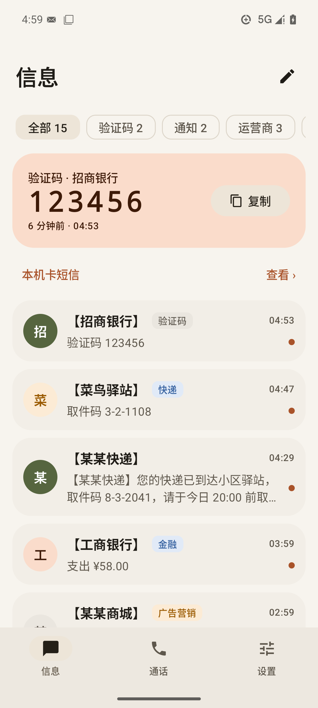 | 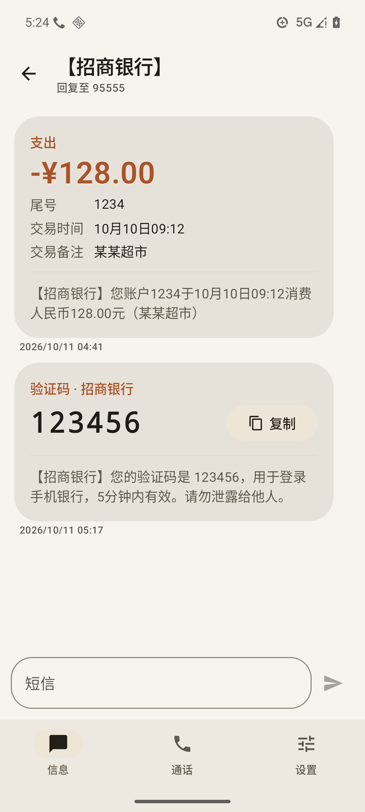 | 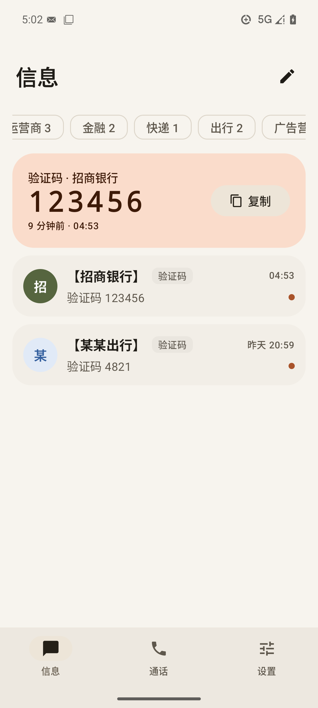 | 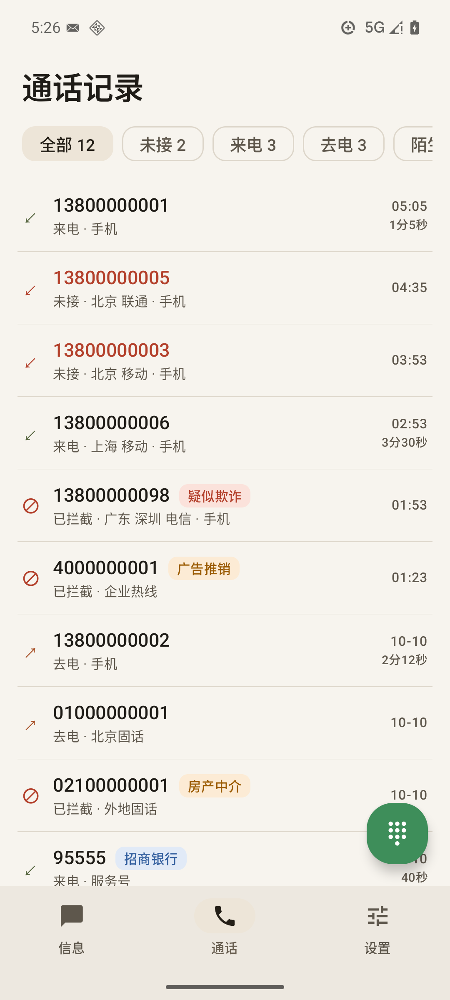 |

| 锁屏来电 | 通话中（深色） | 拦截设置 | 连接诊断 |
|---|---|---|---|
| 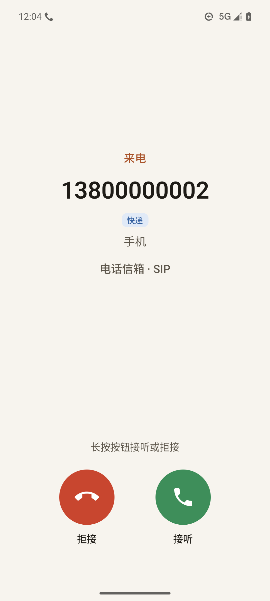 | 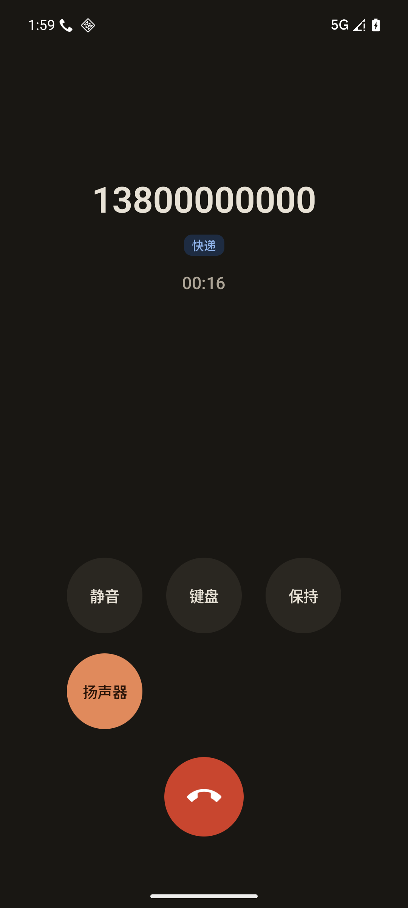 | 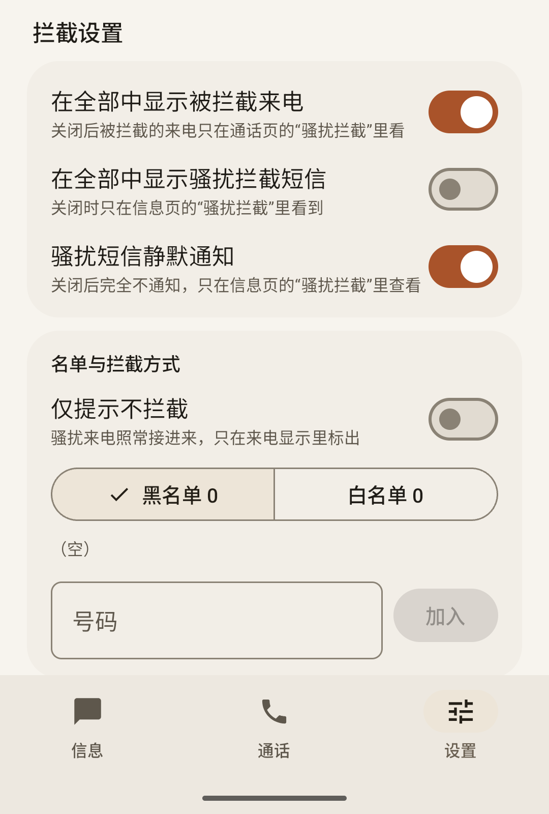 | 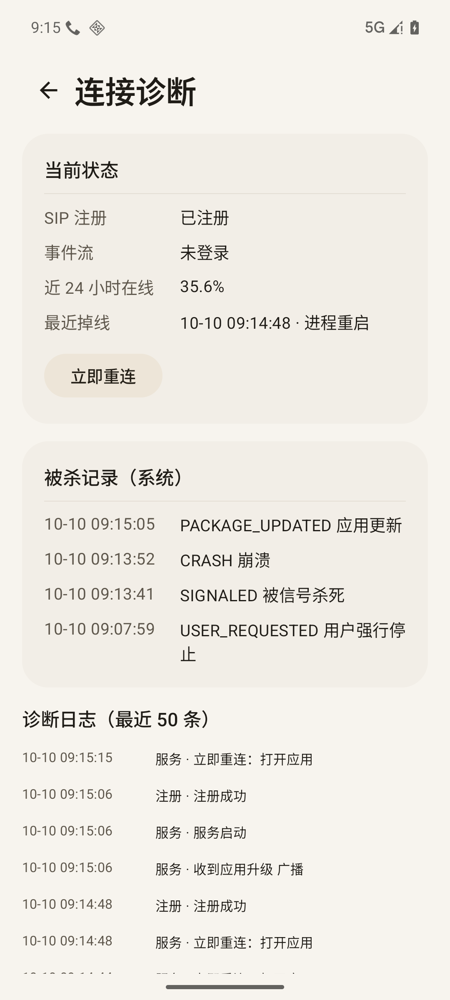 |

| Shizuku 保活体检 | Shizuku 失败详情 |
|---|---|
| 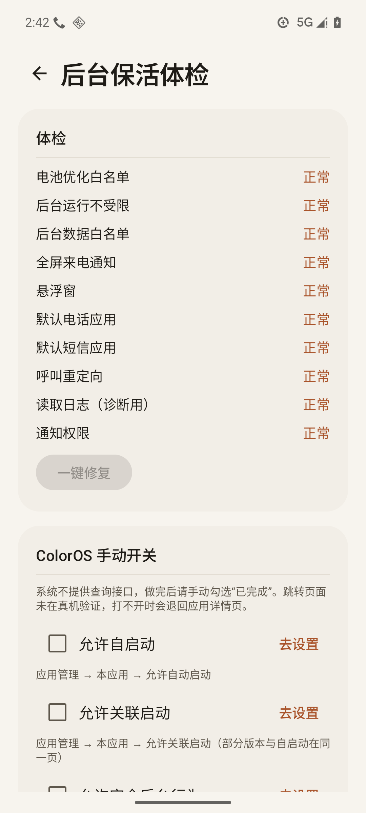 | 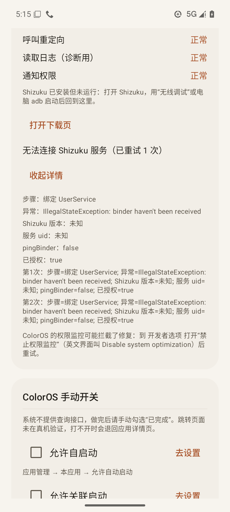 |

折叠屏内屏双栏：

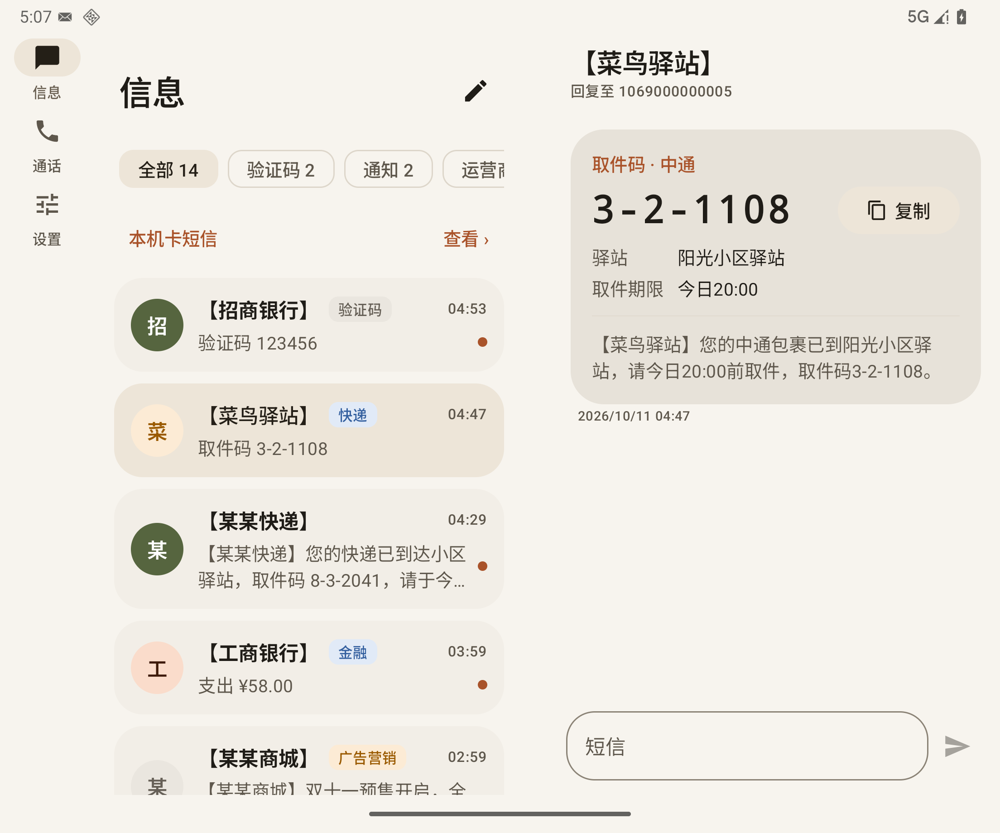

## 架构

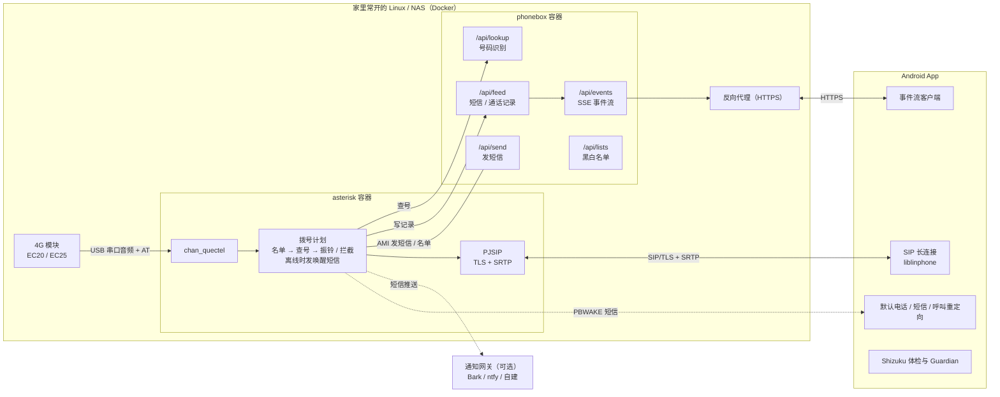

- 来电：4G 模块 → chan_quectel → 拨号计划先查黑白名单，再问 phonebox 号码类型（骚扰 / 诈骗 / 快递……），决定拦截还是转给 App 分机振铃。App 分机离线时，Asterisk 通过 4G 模块给手机本机卡发一条唤醒短信，App 收到后重新注册，再振铃。
- 短信：收到后写入记录，phonebox 分类打分，通过 SSE 实时推给 App；可选再推送到 Bark / ntfy / 自建网关。
- 去电和发短信：App 经 SIP 拨号 / 经 phonebox 接口发短信，都从 4G 模块的卡出去。

## 硬件要求

- **4G 模块**：移远 EC20 / EC25 等 chan_quectel 支持的型号。必须支持**语音（含 VoLTE）**并带 **USB 音频口**（串口音频或 UAC）。只有数据功能的型号不能打电话。能否使用以 [chan_quectel 文档](https://github.com/IchthysMaranatha/asterisk-chan-quectel) 为准。
- **SIM 卡**：能打电话、收短信的卡。有的运营商要先开通 VoLTE。
- **常开的主机**：Linux 或 NAS，x86_64 或 arm64，装好 Docker（带 compose 插件）或 Podman，有 USB 口接模块。
- **手机**：Android 12 及以上，arm64。
- **可选**：公网 IP 或 DDNS，以及路由器端口转发（只在局域网用就不需要）。

## 服务端部署

详细步骤、全部配置项和排错见 [server/README.md](server/README.md)。概要：

```sh
cd server
cp .env.example .env
vi .env                       # 至少改 SIP_DOMAIN、PHONEBOX_ORIGIN；在 NAT 后要外网用就填 EXTERNAL_ADDRESS
scripts/init.sh               # 随机生成口令 / PIN / 唤醒密钥，生成自签 TLS 证书并打印指纹，渲染配置
docker compose up -d --build  # 或 podman compose up -d --build
curl -s http://127.0.0.1:18989/health
```

- 接了 4G 模块后，在 `.env` 里启用 `docker-compose.ec20.yml`，核对 `QUECTEL_AUDIO` / `QUECTEL_DATA`。
- phonebox 只听本机，需要一个 HTTPS 反向代理（自带 Caddy 示例，也可以用已有的）。
- 号码库和垃圾短信模型用 `scripts/update-data.sh` 下载和更新，建议每周 cron 跑一次。
- 离线库没收录的来电号码默认会发给 PixelTelo 的公开接口联网查询（只发号码）；不想这样就在 `.env` 设 `PHONEBOX_TELO_URL=off`，见 [server/README.md](server/README.md)。
- 从旧的手工部署升级见 [server/UPGRADE.md](server/UPGRADE.md)。

## 路由器端口与安全建议

从外网用才需要端口转发。原则是**只暴露加密的入口**：

- 转发 SIP **TLS**（TCP，建议用一个高位端口）和 **RTP 端口段**（UDP，`.env` 的 `RTP_START`–`RTP_END`）。
- 网页 / App 接口只经 HTTPS 反代暴露。
- **不要**转发 5060（UDP/TCP 明文 SIP）。公网上的 SIP 扫描器会日夜不停地猜口令。
- App 在 TLS 下稳定后可以设 `APP_TLS_ONLY=yes`，让 Asterisk 呼叫 App 分机时固定走 TLS。注意它**不能**阻止从 UDP 注册（Asterisk 没有这个选项），防明文注册要靠不转发 5060 和宿主机防火墙，见 [server/README.md](server/README.md)。
- 限速和封禁的思路：
  - 宿主机上用 fail2ban 读 Asterisk 的 security 日志，对连续认证失败的来源封禁；
  - Asterisk 侧可以用 ACL（`acl.conf` / endpoint 的 `permit`/`deny`）限制来源网段；
  - 路由器支持的话，对 TLS 端口做每 IP 新建连接限速，或者按地区限制来源。
- 免登录的 `/api/lookup`、`/api/sms-score` 只允许本机访问，反代上要对公网屏蔽（示例 Caddyfile 已处理）。

具体规则要按你的路由器和网络写，本仓库不提供现成规则。

## App 安装与首次向导

从 Releases 下载 APK 安装（只含 arm64-v8a），或者自己构建（见下文）。首次打开会进入向导：

**SIP 账号**

| 字段 | 填什么 |
|---|---|
| 服务器 | 外网用填 `SIP_DOMAIN`（如 `sip.example.com`）；局域网直连填主机地址（如 `192.168.1.10`） |
| 端口 | 与传输对应：TLS 填路由器上的 TLS 对外端口（`SIP_TLS_PUBLIC_PORT`）；局域网 UDP 填 `SIP_UDP_PORT` |
| 传输 | 推荐 **TLS**；UDP / TCP 仅用于局域网调试 |
| 分机 | `.env` 的 `APP_EXT`（默认 101） |
| 口令 | `grep SIP_APP_PASS server/secrets/sip.env` |
| 证书指纹 | 自签证书时填 `scripts/gen-tls-cert.sh` 打印的 SHA-256 指纹；App 只信任这张证书 |
| SRTP | TLS 下建议打开，通话媒体加密 |

**phonebox**

| 字段 | 填什么 |
|---|---|
| 地址 | 与 `.env` 的 `PHONEBOX_ORIGIN` **完全一致**（协议、域名、端口），如 `https://sms.example.com` |
| 证书指纹 | 反代用正规证书（如 Caddy 自动申请的）就留空；自签证书填它的 SHA-256 指纹 |
| PIN | `cat server/secrets/passcode`。只用来换一个长期设备令牌，App 不保存 PIN |

之后按提示授予通知、麦克风、电话、短信、联系人等权限。

## 默认应用、Root / Shizuku 与后台保活

### 保活分层

| 层 | 解决什么 | 需要什么 | 实测状态 |
|---|---|---|---|
| 常驻前台服务 + 心跳 | 平时在线；断线退避重连，心跳自检兜住断掉的重试链 | 无 | 真机 |
| 默认电话 / 短信应用 | 系统给默认应用的后台特权（可从后台启动前台服务等） | 无 | 真机 |
| Root 一键修复 + Root Guardian | 被杀 7 秒内拉起、被冻结 2 秒内解冻；开机模块自动拉起 | KernelSU / Magisk / APatch | 真机（ColorOS 16） |
| Shizuku 一键修复 + Guardian | 同上的免 root 版本，每次开机要重新激活 Shizuku | Shizuku | 模拟器 + 真机 |
| 短信唤醒 | App 离线时来电，经 4G 模块发短信叫醒 | App 所在手机能收短信 | 模拟器 |
| UnifiedPush 推送唤醒 | SSE 断了时经自建 ntfy 叫醒，来电和短信都会推 | ntfy 服务器 + ntfy App | 服务端已测，App 端未端到端实测 |

诊断页的"近 24 小时在线""最近掉线""被杀记录""短信首达延迟"是判断哪一层出问题的依据。

**Root**：详见 [docs/root.md](docs/root.md)。**推送唤醒**：详见 [docs/push.md](docs/push.md)。

**默认应用**：在"设置 → 默认应用"里依次设为默认电话、默认短信和呼叫重定向应用。之后：

- 普通号码默认经 SIP 从家里的卡拨出；紧急号码永远走手机本机网络；
- SIP 未注册时自动回落到本机网络并提示；
- 成为默认短信应用后才能接收唤醒短信。

**Shizuku**（可选，推荐）：用无线调试或 adb 激活 [Shizuku](https://shizuku.rikka.app/) 后，在"设置 → 后台保活体检"里授权并"一键修复"。它会用固定的命令模板把本 App 加入电池优化白名单、后台运行和后台数据白名单、允许悬浮窗和全屏通知、设为三个默认应用、授予读取日志权限（用于诊断页的"被杀记录"）。执行读取日志授权时 App 进程会被系统重启一次，属正常现象。详见 [docs/shizuku.md](docs/shizuku.md)。

免 root 的 Shizuku 每次重启手机都要重新激活；Guardian（每 60 秒检查常驻服务，不在就拉起）也随之停止。社区有开机后自动激活的 Shizuku 分支可以选用。

**ColorOS 等国产 ROM**：系统不提供查询接口，体检页列出手动开关清单并给出跳转入口：

1. 允许自启动
2. 允许关联启动
3. 允许完全后台行为
4. 电池不优化
5. 横幅和锁屏通知全部打开
6. 在最近任务里锁定本 App

另外 ColorOS 的"权限监控"可能拦截 Shizuku 执行的命令，修复失败时到开发者选项里打开"禁止权限监控"（Disable system optimization）再试。这些跳转入口来自社区资料，**没有在各家 ROM 的真机上逐一验证**，打不开时会退回应用详情页。能否长期在线需要你在自己手机上实测（诊断页有 24 小时在线比例、掉线原因和被杀记录）。

## 短信唤醒

系统可能杀掉 App 的后台连接。App 分机离线时有来电，Asterisk 会经 4G 模块给 App 所在手机发一条短信：

```
PBWAKE:<unix 秒>:<HMAC-SHA256 前 16 位十六进制>
```

App 用共享密钥校验时间和签名，通过后拉起服务重新注册，Asterisk 最多等 `WAKE_WAIT` 秒（默认 12）再振铃。校验通过的唤醒短信不会出现在收件箱。

配置（两边必须是同一个密钥）：

1. 服务端：`scripts/set-wake.sh <App 所在手机的号码>`，密钥在 `secrets/wake_key`；
2. App：把 `secrets/wake_key` 的内容填进"设置 → 默认应用 → 短信唤醒密钥"。

前提是本 App 是默认短信应用、手机本机卡能收短信。**每条唤醒短信按运营商短信计费**，两次唤醒至少间隔 `WAKE_INTERVAL` 秒（默认 300）。不需要可以 `scripts/set-wake.sh --off`。

## 常见问题

- **phonebox 登录一直提示 PIN 错误**：多半不是 PIN 错，而是 App 里填的地址和服务端 `PHONEBOX_ORIGIN` 不一致（协议、域名、端口必须完全相同），服务端会拒绝（403），App 显示成 PIN 错误。15 分钟内错 5 次会锁 15 分钟。
- **Shizuku 一键修复失败**：点"详情"，看这几个字段：
  - **步骤**：绑定 UserService / 绑定超时 / 执行模板；
  - **异常**：类名和消息；
  - **Shizuku 版本**、**服务 uid**：2000 是 adb/无线调试激活，0 是 root，"未知"表示连不上服务；
  - **pingBinder**、**已授权**；
  - 绑定失败时有"第 1 次 / 第 2 次"两行；命令失败时有每条命令的退出码和输出。

  大致判断：pingBinder=false、版本未知 → Shizuku 没在运行，重新激活；pingBinder=true 但"绑定超时" → 系统限制了关联启动 / 自启动；"执行模板"且退出码非 0 → 多半是 ROM 的权限监控拦了命令。"设置 → 连接诊断"的日志里也有同样的内容。
- **在家连 Wi-Fi 时总是掉线、出门就好**：多半是路由器没有给 SIP TLS 端口做**回环 NAT（hairpin）**。手机在局域网里访问你的公网域名时，请求发到路由器的公网地址，只配了"从 WAN 进来才转发"的规则不会生效，于是 TLS 连不上（诊断页表现为整晚 `SSLHandshakeException` 或 `ConnectException`）。给 TLS 端口加一条和 WAN 转发对应的回环规则即可；手机上开着 Clash 等代理时，也要让本 App 的流量直连或确保代理出口能访问你的域名。
- **TLS 注册不上**：确认路由器转发的是 TCP、端口与 `SIP_TLS_PUBLIC_PORT` 一致、App 里的指纹与 `gen-tls-cert.sh` 打印的一致。
- **能注册没声音**：RTP 端口段没转发，或 `EXTERNAL_ADDRESS` / `LOCAL_NET` 不对。
- 更多服务端问题见 [server/README.md](server/README.md#常见问题)。

## 已知限制

- **后台存活没有保证**：ColorOS 等国产 ROM 上能否长期在线、来电能否可靠送达，需要在你的手机上实测。有 root 时 Root Guardian 能把被杀、被冻结的 App 很快拉回来，但挡不住网络层面的问题；短信唤醒和推送唤醒是兜底，不是保证。
- **不支持小米 / OPPO / vivo / 华为 / 荣耀等厂商推送**：它们多数要求企业开发者账号和应用上架，自建自用的项目用不上，原因见 [docs/push.md](docs/push.md)。
- **真机验证有限**：主要功能在 Android 模拟器和本地测试容器里验证过；不同手机、不同 ROM 的表现、真实运营商短信的识别率都可能不同。
- **未开启 R8 混淆压缩**，加上 liblinphone 的原生库，APK 约 75 MB。
- 短信卡片识别依赖 PixelText 的规则，格式不同的短信只显示原文。
- chan_quectel 只在 x86_64 上实际构建过，arm64 没有实测。

## 构建与签名

```sh
cd android
./gradlew assembleDebug testDebugUnitTest   # 需要 JDK 21 和 Android SDK
```

release 包的签名配置从仓库外的文件读取，仓库里没有任何密钥。自签步骤见 [android/SIGNING.md](android/SIGNING.md)。

**关于包名**：包名 `top.xingzhenxi.phonebox` 是原作者的，保留它是为了让已安装的用户能覆盖升级。fork 后可以改成自己的，改法见 [android/SIGNING.md](android/SIGNING.md#fork-后改包名)。注意 Android 只允许"包名相同且签名相同"的包覆盖安装。

## 接口文档

- [docs/api-events.md](docs/api-events.md)：设备令牌与 SSE 事件流协议。
- [docs/shizuku.md](docs/shizuku.md)：Shizuku 实际执行的命令与 Guardian。

## 致谢与许可

本项目以 **GPL-3.0** 发布（App 链接了 GPLv3 的 liblinphone），全文见 [LICENSE](LICENSE)。

感谢这些项目，具体借用了什么见 [NOTICE](NOTICE)：

- [PixelTelo](https://github.com/Pixel-Tailor-CN/PixelTelo)（Apache-2.0）：号码库格式与识别思路
- [PixelText](https://github.com/Pixel-Tailor-CN/PixelText)（Apache-2.0）：短信解析规则与卡片样式
- [Shizuku](https://github.com/RikkaApps/Shizuku)（Apache-2.0）
- [liblinphone / Linphone SDK](https://gitlab.linphone.org/BC/public/liblinphone)（GPLv3）
- [Asterisk](https://www.asterisk.org/)（GPLv2）
- [asterisk-chan-quectel](https://github.com/IchthysMaranatha/asterisk-chan-quectel)（GPLv2）

仓库地址：https://github.com/xiigggg/phonebox
